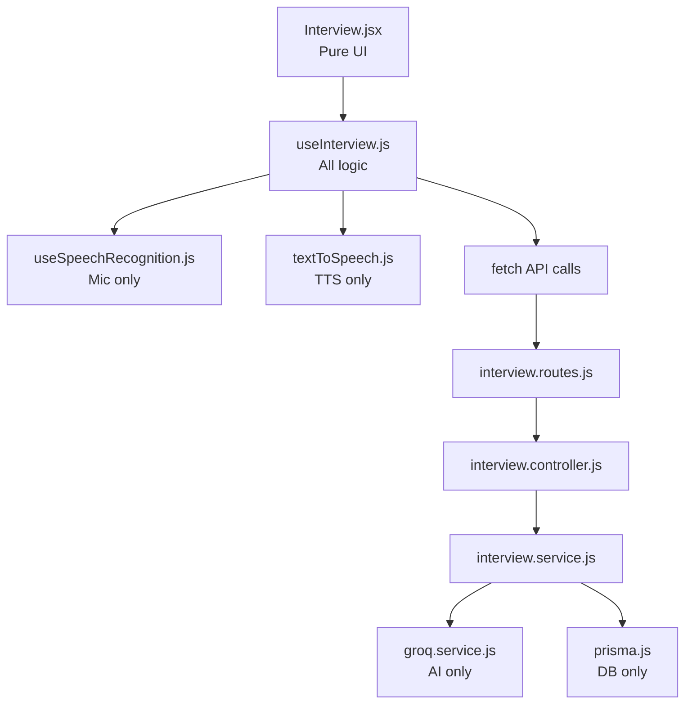
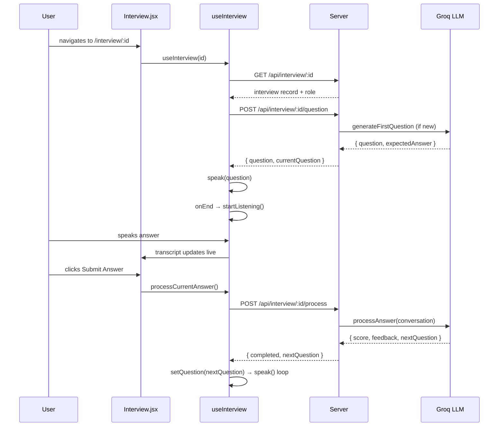
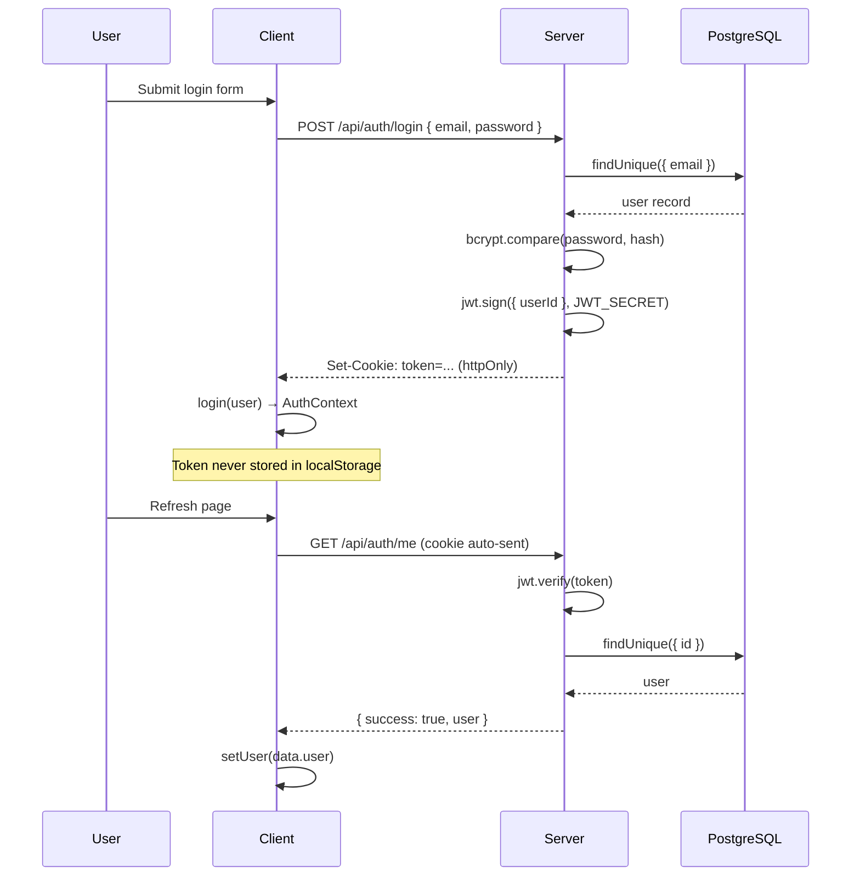

# Architecture

## System Overview

```
┌──────────────────────────────────────────────────────────────────┐
│                        Browser (Client)                          │
│                                                                  │
│  React SPA (Vite + Tailwind)                                     │
│                                                                  │
│  AuthProvider                                                    │
│  └── BrowserRouter                                               │
│      ├── Navbar  (always visible)                                │
│      ├── App     (routes)                                        │
│      │   ├── Home           → Hero + Plan + Testimonials         │
│      │   ├── NewInterview   → form + JDs                        │
│      │   ├── Interview      → useInterview() + sub-components    │
│      │   │   ├── useInterview (all logic)                       │
│      │   │   │   ├── useSpeechRecognition (mic + transcript)    │
│      │   │   │   └── textToSpeech.js     (AI voice output)      │
│      │   │   ├── InterviewHeader                                 │
│      │   │   ├── InterviewMeta                                   │
│      │   │   ├── InterviewControls                               │
│      │   │   ├── AiPreview                                       │
│      │   │   ├── CameraPreview                                   │
│      │   │   └── TranscriptPanel                                 │
│      │   └── Profile  (private)                                  │
│      └── Footer (always visible)                                 │
└──────────────────┬───────────────────────────────────────────────┘
                   │  HTTP + httpOnly cookie (JWT)
┌──────────────────▼───────────────────────────────────────────────┐
│                      Express Server                              │
│                                                                  │
│  Middleware: cors → cookieParser → express.json                  │
│                                                                  │
│  Routes                                                          │
│  ├── /api/auth       auth.routes.js                              │
│  ├── /api/interview  interview.routes.js → authMiddleware         │
│  └── /api/dashboard  dashboard.routes.js → authMiddleware         │
│                                                                  │
│  Controllers → Services → Prisma ORM → PostgreSQL               │
│                        ↘                                         │
│                    groq.service.js → Groq API (LLaMA 3.3)        │
└──────────────────────────────────────────────────────────────────┘
```

## Separation of Concerns



## Data Flow — Interview Session



## Authentication Flow


